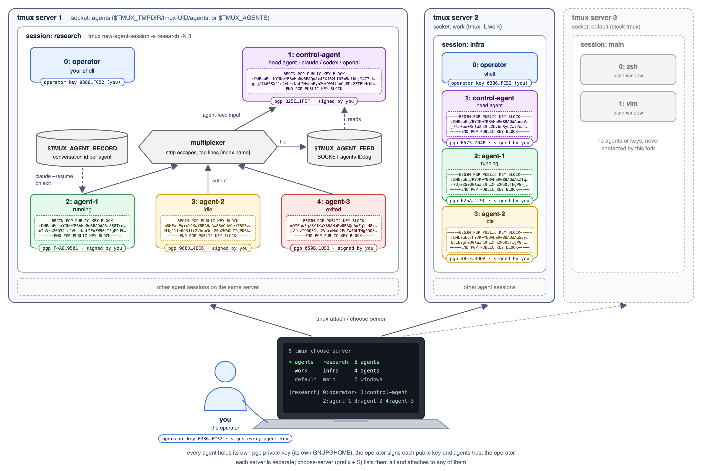

# custom tmux for agent sessions

A tmux fork where a session can run a team of CLI agents (claude, codex or
openai). Each agent is a window running one agent process. The first window
is `planning`, an agent for planning only (claude runs with
`--permission-mode plan`); the second is `operator`, a shell for you; the third
is `control-agent`, the head agent, which gets the output of every other agent
as one multiplexed stream.

Feed lines look like:

    [3:agent-1] wrote parser.c
    [4:agent-2] tests passing

Every agent session lives in one tmux server, reached through its own socket
(`agents`, or the name in `$TMUX_AGENTS`), so it never talks to a stock tmux
server. `tmux choose-server` lists this server alongside any others.

## Build

    sh autogen.sh && ./configure && make
    ln -s "$PWD/tmux" ~/.local/bin/tmux    # put ~/.local/bin first in PATH

If `tmux -V` still shows the stock version in an old shell, run `rehash`.

## Commands

    tmux new-agent-session -s research          # planning, operator, control-agent
    tmux new-agent-session -s research -N 3     # ... + agent-1..agent-3
    tmux new-agent-session -s research -a codex # use codex instead of claude
    tmux new-agent-session -s research -N 3 -l  # each agent in its own git worktree
    tmux new-agent -t research                  # add an agent to a session
    tmux set-agent-task -p -t agent-1 'Write the parser'  # give agent-1 its task
    tmux attach -t research

Aliases: `newas`, `newa` and `setat`.

The planning agent is told to hand out tasks with `set-agent-task`; `-p` also
sends the task to the agent as a prompt and `-u` clears it. Without one, an
agent's task is its pane title, which claude sets.

## Servers

    tmux choose-server                          # or prefix + S

Shows every tmux server with a socket in the socket directory (this fork's
`agents`, a stock `default` and any `-L` servers), with their sessions and
windows underneath. Agent sessions list their agents with their status
(`running`, `idle` or `exited`), their task and key fingerprint. An idle
agent waiting on a question shows it, so you need not open its window:

    q1: 4 agents, 1 waiting
    3: agent-1 [idle] Write the parser "Do you want to make this edit to parser.c?" 96D2...

The question is the lowest line on the agent's screen ending in `?`. The
preview shows the selected window, even on another server; for an agent on
this server it starts with the question and the agent's armored public key.

Enter on a session or window of another server replaces the client with one
attached to that server, using the binary that runs it, so a stock tmux
server works too. If that fails the client comes back to the current server.

## Git worktrees

With `-l` (the `agent-local` option), each agent checks out its own git
worktree of the repository it starts in, at `<repo>-agents/<session>/<agent>`
on branch `agents/<session>/<agent>`, so agents never edit the same tree.
Worktrees are reused by a later session of the same name. Merge an agent's
work with `git merge agents/research/agent-1`; remove it with
`git worktree remove <path>`.

## Agent identity

Every agent (`planning`, `control-agent` and each `agent-N`) has its own OpenPGP identity:
an ed25519 key made with `gpg` in its own GnuPG home,
`<socket dir>/agent-keys/<agent id>` (mode 0700). Inside the agent,
`GNUPGHOME` points there and `TMUX_AGENT_ID` is set, so only that agent holds
its private key:

    gpg --clearsign report.md            # inside agent-1: signs as research/agent-1

You, the operator, certify every agent. When a session is created, once
every agent has a key, each agent's public key is imported into your keyring
and signed with your key (gpg may ask for your passphrase). Your public key
and the signed agent keys are then written to `$TMUX_AGENT_KEYS` and given to
every agent, which trusts your key, so agents verify each other through your
signature (`gpg --verify` shows `Good signature ... [full]`). Agents never
sign each other's keys. An agent added later with `new-agent` is signed and
distributed the same way.

By default your first secret key is used; pick another with:

    tmux set -g agent-operator-key you@example.com

Fingerprints are listed in the last column of `$TMUX_AGENT_RECORD`. Keys have
no passphrase so agents can sign unattended; they are protected by the
directory permissions.

## Cloud servers

    tmux provision-server -p gcp web-1                     # GCP, us-central1-a, e2-small
    tmux provision-server -p aws -l eu-west-1 -k key api-1 # AWS, t3.small
    tmux provision-server -p azure -m Standard_B2s db-1    # Azure, eastus
    tmux delete-provisioned-server api-1

Creates or deletes a VM with the provider's CLI (`gcloud`, `aws` or `az`),
which must be installed and logged in. `-l` is the zone or region, `-m` the
machine type, `-i` the image and `-k` the AWS key pair. Defaults:

| provider | location        | machine        | image             |
|----------|-----------------|----------------|-------------------|
| `gcp`    | `us-central1-a` | `e2-small`     | Debian 12         |
| `aws`    | `us-east-1`     | `t3.small`     | Amazon Linux 2023 |
| `azure`  | `eastus`        | `Standard_B1s` | Debian 12         |

Each server is recorded (name, provider, location, id) in `provisioned` in
the socket directory, so `delete-provisioned-server` only needs the name. On
Azure each server gets its own resource group, `tmux-<name>`, which is deleted
with it. Servers made elsewhere can be deleted with `-p` and `-l`.

## Options

| option               | values                         | default  |
|----------------------|--------------------------------|----------|
| `agent`              | `claude`, `codex`, `openai`    | `claude` |
| `agent-count`        | number of agents besides head  | `0`      |
| `agent-command`      | command for the agents         | empty    |
| `head-agent-command` | command for the head agent     | empty    |
| `planning-command`   | command for the planning agent | empty    |
| `agent-feed`         | `off`, `file`, `input`, `both` | `file`   |
| `agent-restore`      | `on`, `off`                    | `on`     |
| `agent-local`        | `on`, `off`                    | `off`    |
| `agent-operator-key` | key that signs agents' keys    | first secret key |

    tmux set -g agent codex
    tmux set -t research agent-command 'claude --model opus'
    tmux set -t research agent-feed both

With `agent-feed file`, agent output is written as `[index:name] line` to the
file named by `$TMUX_AGENT_FEED`. With `input`, it is typed into the head
agent.

## Agent context

Every claude agent (including `control-agent`) gets its own conversation,
started with `claude --session-id <uuid>`. The session records each agent's
conversation in the file named by `$TMUX_AGENT_RECORD`
(`SOCKET-SESSION.agents`, next to the socket), which is kept after the
session ends:

    # session research: index name role conversation restores cwd key
    0	planning	planning	5e0c1a2d-...	0	/src/app	A41F09C2D7B3E815...
    2	control-agent	control	98357576-...	0	/src/app	629129354411D1FE...
    3	agent-1	agent	1392b7be-...	1	/src/app	67CBDC32C51EE6A2...

If a claude agent exits or crashes, it is restarted in the same window with
`claude --resume <uuid>`, so it picks up its saved context. An agent that
exits five times within 30 seconds is left closed, and killing an agent's
window or pane never restarts it. Turn it off with
`tmux set -t research agent-restore off`.

To bring back an agent by hand, even after the server is gone:

    cd /src/app && claude --resume 1392b7be-167f-4872-9e55-ac525201dc94
