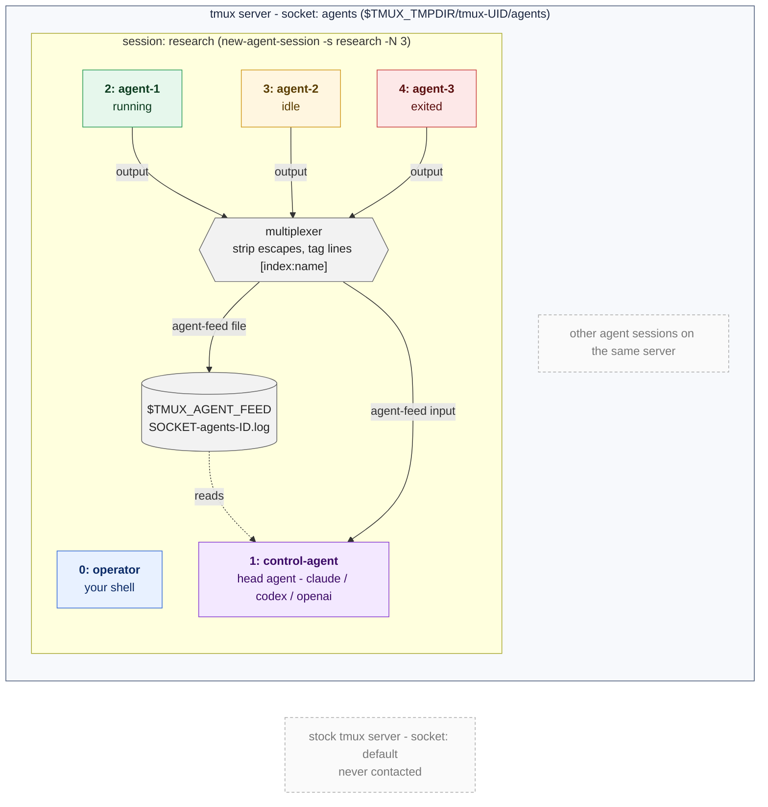

# custom tmux for agent sessions

A tmux fork where a session can run a team of CLI agents (claude, codex or
openai). Each agent is a window running one agent process. The first window
is `operator`, a shell for you; the second is `control-agent`, the head agent,
which gets the output of every other agent as one multiplexed stream.

Feed lines look like:

    [2:agent-1] wrote parser.c
    [3:agent-2] tests passing

Every agent session lives in one tmux server, reached through its own socket
(`agents`, or the name in `$TMUX_AGENTS`), so it never talks to a stock tmux
server. `tmux choose-server` lists this server alongside any others.

## Build

    sh autogen.sh && ./configure && make
    ln -s "$PWD/tmux" ~/.local/bin/tmux    # put ~/.local/bin first in PATH

If `tmux -V` still shows the stock version in an old shell, run `rehash`.

## Commands

    tmux new-agent-session -s research          # operator + control-agent
    tmux new-agent-session -s research -N 3     # ... + agent-1..agent-3
    tmux new-agent-session -s research -a codex # use codex instead of claude
    tmux new-agent -t research                  # add an agent to a session
    tmux attach -t research

Aliases: `newas` and `newa`.

## Servers

    tmux choose-server                          # or prefix + S

Shows every tmux server with a socket in the socket directory (this fork's
`agents`, a stock `default` and any `-L` servers), with their sessions and
windows underneath. Agent sessions list their agents with their status
(`running`, `idle` or `exited`). The preview shows the selected window, even
on another server.

Enter on a session or window of another server replaces the client with one
attached to that server, using the binary that runs it, so a stock tmux
server works too. If that fails the client comes back to the current server.

## Options

| option               | values                         | default  |
|----------------------|--------------------------------|----------|
| `agent`              | `claude`, `codex`, `openai`    | `claude` |
| `agent-count`        | number of agents besides head  | `0`      |
| `agent-command`      | command for the agents         | empty    |
| `head-agent-command` | command for the head agent     | empty    |
| `agent-feed`         | `off`, `file`, `input`, `both` | `file`   |

    tmux set -g agent codex
    tmux set -t research agent-command 'claude --model opus'
    tmux set -t research agent-feed both

With `agent-feed file`, agent output is written as `[index:name] line` to the
file named by `$TMUX_AGENT_FEED`. With `input`, it is typed into the head
agent.
